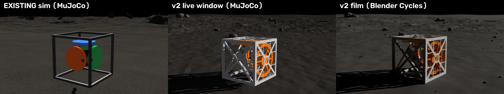

# Graphics decision: existing sim vs v2

The same moment (cube resting at its start pose, after 1 s of settling) and the same camera geometry: v2's Blender
`cine` shot, 0.72 m away, 10° above, 35° orbit, 40 mm lens.

| File | How it was made |
|---|---|
| `graphics/existing_mujoco.png` | `./vpy tools/graphics_compare.py mujoco` (existing `psyche_cubli.py`, MuJoCo renderer) |
| `graphics/v2_mujoco.png` | same command (v2 world, what the live window shows) |
| `graphics/v2_blender.png` | `Blender -b -P render_blender.py -- --rec recordings/demo.npz --still 2.0 --quality preview --cam cine` (Blender 5.4, Cycles on the Metal GPU) |

| Criterion | existing (MuJoCo) | v2 live (MuJoCo) | v2 film (Blender Cycles) |
|---|---|---|---|
| Real CAD visible | no: 8 mm box struts, colored discs, a green "PCB" box | yes: the assembly STL frame + wheel meshes | yes, with smooth normals and a PLA material with slight subsurface |
| Sunlight model | MuJoCo directional light, arbitrary intensity | MuJoCo directional light, arbitrary intensity, low sun (22°) | 162 W/m² (PAPER: 1361/2.9²), 0.18° sun disc (razor shadows), AgX exposure −5.1 |
| Black airless sky | yes (black + random star marks) | yes (black + random star marks) | yes; stars only on camera rays (`--stars none` = what a real camera shows) |
| Regolith | flat-color random texture | flat-color random texture | procedural dark-grey FeNi regolith: albedo ramp, ~1 mm metal glints, 5 mm / 0.5 mm micro-relief |
| Pebbles | none | none | 8k (preview) to 120k (film) instanced pebbles + cobbles |
| Boulders | smooth ellipsoids | smooth ellipsoids | displaced, faceted, partly buried (same footprint as the MuJoCo collision ellipsoids) |
| Curved horizon | no (flat 24 m patch) | yes (patch on the ellipsoid + far-field ring to 1.5 km) | yes (same mesh) |
| Motion blur | no | no | yes (cube + wheels from the real wheel angle, 0.5 shutter; off for the intro) |
| Dust | no | no | yes: ballistic ejecta at every recorded impact under Psyche gravity |

## Decision: v2 wins. Keep both of its layers.

- **Live window:** v2 MuJoCo, because it shows the real CAD and the curved horizon at interactive speed.
- **Film:** v2's Blender pipeline (record → `render_blender.py` → mp4), with its tuned values unchanged:
  - `hair_length 1.0` for pebbles
  - dust count `v*25000` clipped to 300–4000, 1.1 mm grains, ejection speed `0.5*v`
  - intro without motion blur
  - f-stops 16 / 11 / 8 for the wide, cine and low shots

**Ported from the existing sim: nothing**, since the winner already covers every criterion.

**Blender 5.4 note:** `render_blender.py` runs as-is. It prints two "removed in Blender 6.0" deprecation warnings (`World.use_nodes`, `Material.use_nodes`). The first Cycles run on this Mac took about 10 minutes of wall time, mostly the one-time compile of the Metal GPU kernels.
